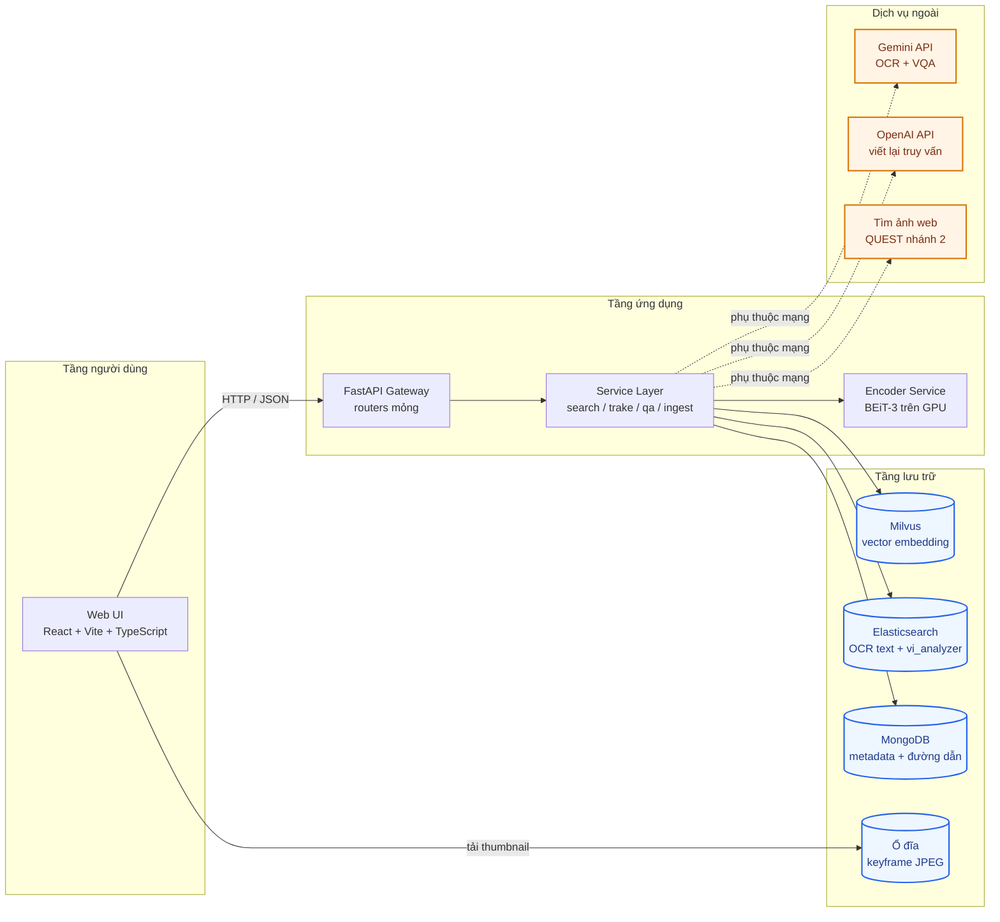
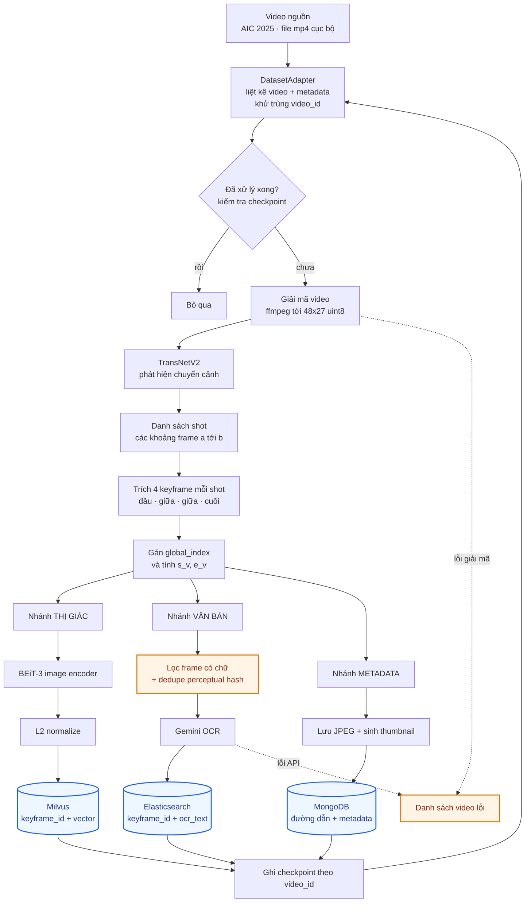
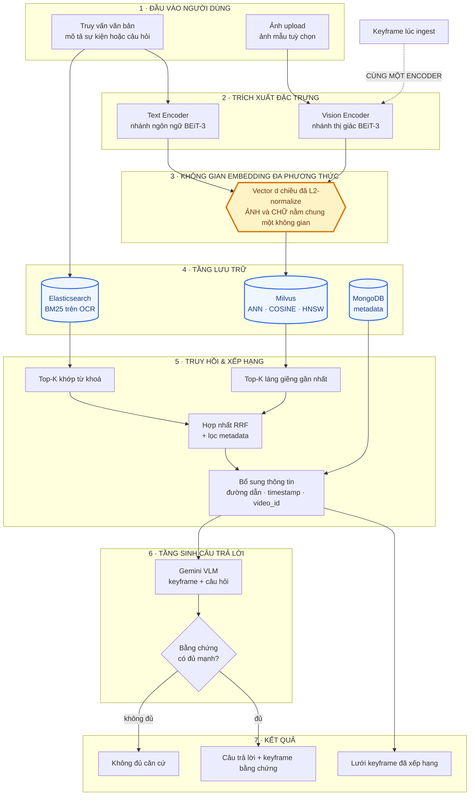
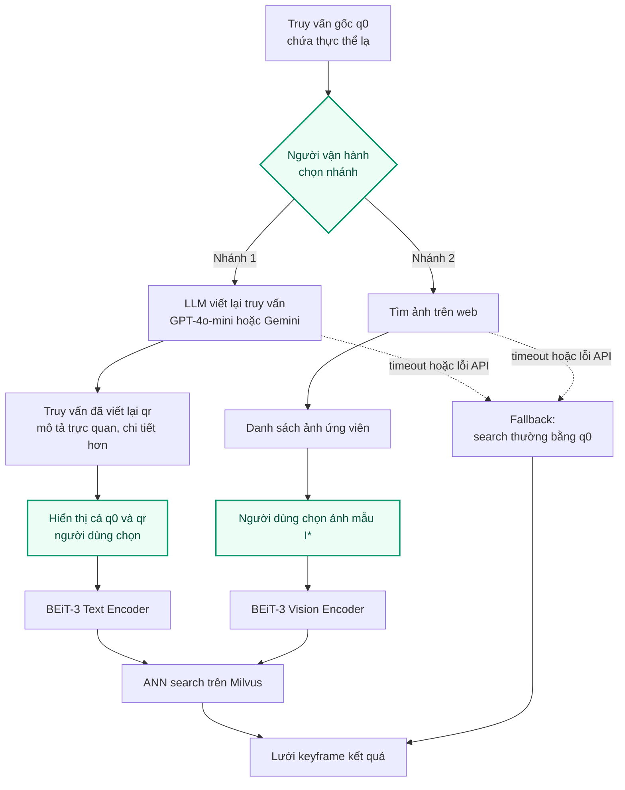
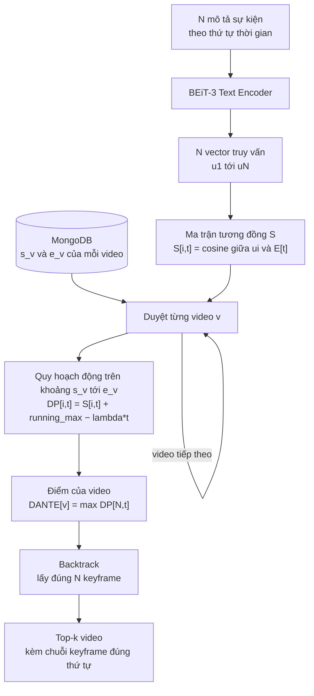
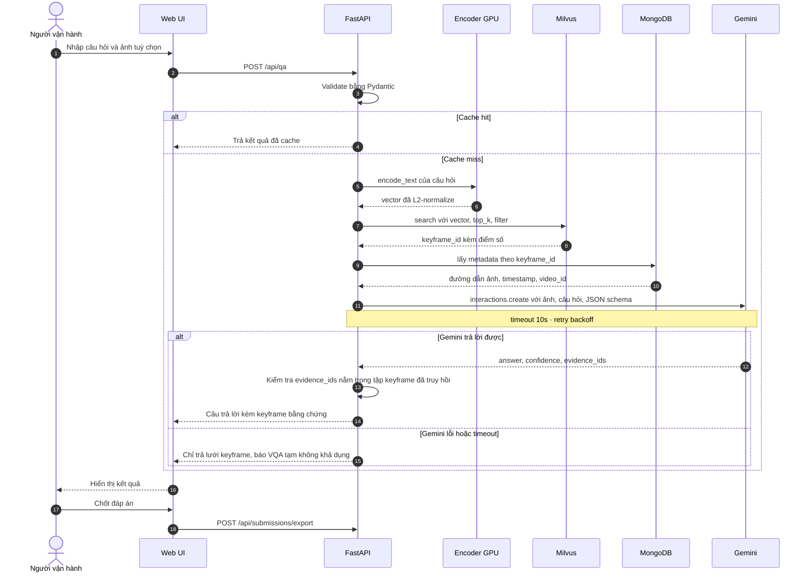
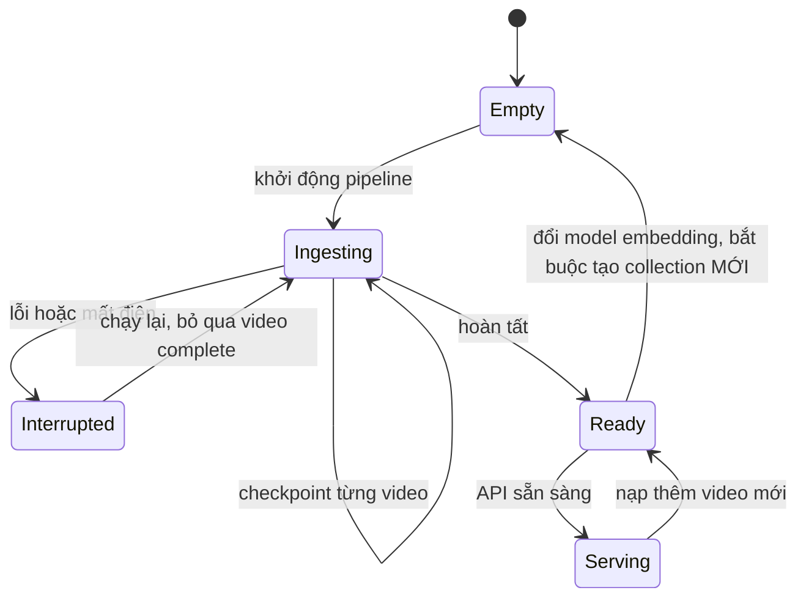

# Kiến trúc hệ thống — AIC Video Retrieval

> **Phiên bản:** 0.2 · **Ngày:** 2026-07-29 (bản 0.1: 2026-07-25)
> **Thay đổi 0.1 → 0.2:** dataset chuyển từ YouCook2 sang **AIC 2025 công khai**. Ảnh hưởng: §1 · §3.2 · §4.1 · §4.3 · §5.2 (**viết lại**) · §6 · §10.
> **Baseline:** [arXiv:2512.13169](https://arxiv.org/abs/2512.13169)
> **Tài liệu liên quan:** [`PRD.md`](./PRD.md) · [`references.md`](./references.md)

Ký hiệu: 📄 **[Paper]** = trích từ baseline · 🔧 **[Giả định]** = quyết định của dự án.

---

## 1. Tư tưởng thiết kế

Hệ thống được tổ chức quanh **một ý tưởng cốt lõi**: đưa ảnh và văn bản về **cùng một không gian vector**. Khi đã ở chung không gian, mọi thứ khác trở thành hệ quả:

- Tìm ảnh bằng câu chữ = mã hoá câu chữ rồi tìm láng giềng gần nhất
- Tìm ảnh bằng ảnh = mã hoá ảnh rồi tìm láng giềng gần nhất
- Tìm chuỗi sự kiện theo thời gian = quy hoạch động trên ma trận tương đồng trong chính không gian đó

Đây là lý do sơ đồ §3.3 (luồng multimodal) là sơ đồ trung tâm của tài liệu này: nó cho thấy **encoder dùng lúc index và encoder dùng lúc query phải là một** — nếu hai bên lệch nhau, toàn hệ thống vô nghĩa.

Ba nguyên tắc kiến trúc kéo theo:

| Nguyên tắc | Vì sao | Hiện thực hoá |
|---|---|---|
| **Tách encoder khỏi pipeline** | BEiT-3 rất khó cài (rủi ro R1 trong PRD). Phải đổi được backbone mà không viết lại pipeline | `MultimodalEncoder` Protocol (§5.1) |
| **Tách dataset khỏi pipeline** | Hôm nay pilot `L21`–`L24`, mai là đủ 873 video, mốt là batch mới BTC phát hành | `DatasetAdapter` Protocol (§5.2) |
| **Tách offline khỏi online** | Ingest chạy hàng chục giờ; query phải trả lời trong vài trăm ms. Hai chế độ vận hành hoàn toàn khác nhau | Hai luồng riêng (§3.2 và §3.3), giao nhau duy nhất tại tầng lưu trữ |

---

## 2. Tổng quan hệ thống

### 2.1 Sơ đồ container



**Đường nét đứt = phụ thuộc mạng.** Đây là ranh giới suy giảm chức năng: khi mất mạng, semantic search và DANTE vẫn chạy đầy đủ; chỉ QUEST, OCR và VQA ngừng hoạt động (yêu cầu T5 trong PRD).

### 2.2 Bảng thành phần

| Thành phần | Công nghệ | Nguồn | Vai trò |
|---|---|---|---|
| Shot segmentation | TransNetV2 | 📄 Paper | Cắt video thành shot |
| Visual/Text encoder | BEiT-3 (`beit3_base_itc`) | 📄 Paper | Đưa ảnh và chữ về chung không gian vector |
| OCR | Gemini API | 📄 Paper | Đọc chữ trên keyframe |
| Vector DB | Milvus | 📄 Paper | ANN search theo cosine |
| Text search | Elasticsearch + `vi_analyzer` | 📄 Paper | BM25 trên OCR text tiếng Việt |
| Metadata | MongoDB | 📄 Paper | Đường dẫn ảnh, thông tin video |
| Viết lại truy vấn | GPT-4o-mini / Gemini | 📄 Paper | QUEST nhánh 1 |
| VQA answering | Gemini API | 🔧 Giả định | Sinh câu trả lời có grounding |
| Backend | FastAPI + Pydantic | 🔧 Giả định | Paper không nêu framework |
| Frontend | React + Vite + TS | 🔧 Giả định | Paper không nêu framework |

---

## 3. Luồng dữ liệu

### 3.1 Hai chế độ vận hành

| | **Offline — Ingest** | **Online — Query** |
|---|---|---|
| Tần suất | Một lần cho mỗi video | Mỗi request người dùng |
| Ngân sách thời gian | Hàng giờ | Hàng trăm mili-giây |
| Nút thắt | Giải mã video, gọi OCR | Gọi encoder, ANN search |
| Với tầng lưu trữ | **Ghi** | **Đọc** |

Chúng giao nhau tại đúng một điểm: **tầng lưu trữ**, và bắt buộc dùng **cùng một encoder**.

### 3.2 Luồng Ingest (offline)



**Bốn điểm cần chú ý trong sơ đồ này:**

1. **Node `Gán global_index và tính s_v, e_v`** — 📄 Paper lưu ở MongoDB `{video_id, s_v, e_v}`. Đây là **điều kiện tiên quyết của DANTE**: thuật toán quy hoạch động chạy trên khoảng index `[s_v, e_v]` của từng video. Bỏ bước này thì DANTE không thể triển khai.

2. **Node `Lọc frame có chữ + dedupe`** 🔧 — paper gọi Gemini OCR trên **mọi** keyframe; điều này bất khả thi về chi phí và quota (rủi ro R2). Keyframe 1280×720 tốn **516 token/ảnh**, và chỉ riêng 177k keyframe BTC trích sẵn đã là ~91,5 triệu token. Bước lọc này là bổ sung của dự án. ⚠️ Với video tin tức, **`dedupe` mới là bước tiết kiệm chính** chứ không phải `lọc frame có chữ` — bản tin có chữ ở gần như mọi frame, nhưng giữ nguyên khung đồ hoạ suốt nhiều giây liền.

5. **Node `DatasetAdapter`** — ngoài việc liệt kê video, nó phải **khử trùng `video_id`**: dataset có 961 file `.mp4` nhưng chỉ 873 id duy nhất (`Videos_L25_a1` và `Videos_L25_b` lặp lại id của `Videos_L25_a`). Bỏ bước này thì 88 video bị ingest hai lần, và mẫu số của mọi báo cáo metric bị thổi phồng.

3. **Vòng lặp checkpoint** — `Z → B` khép kín để pipeline resume được (yêu cầu T1).

4. **Ba nhánh song song** — chúng độc lập, có thể chạy đồng thời hoặc tách thành ba lần chạy riêng. Trên máy 11GB VRAM, chạy tuần tự từng nhánh thường an toàn hơn.

### 3.3 ⭐ Luồng truy vấn Multimodal (online)

Đây là sơ đồ trung tâm. Nó thể hiện đúng luồng: **Upload (Image + Text) → Trích đặc trưng (Vision & Text) → Multimodal Embedding → Vector DB → Retrieval → VLM/LLM → Kết quả**.



**Ba điều sơ đồ này muốn nói:**

1. **Khối 3 là trái tim hệ thống.** Text encoder và vision encoder đổ vào *cùng một* không gian vector. Đây là lý do một truy vấn chữ có thể tìm ra ảnh, và một ảnh upload có thể tìm ra ảnh khác — không cần hai index riêng.

2. **Mũi tên nét đứt `Keyframe lúc ingest → Vision Encoder`** là ràng buộc quan trọng nhất và dễ vi phạm nhất: vector trong Milvus được sinh lúc ingest, vector truy vấn được sinh lúc query. Nếu hai bên dùng model hoặc tiền xử lý khác nhau, kết quả sẽ sai một cách âm thầm — không crash, chỉ là điểm số tệ không rõ lý do. Vì vậy §7.5 của PRD quy định: **đổi model embedding phải tạo collection Milvus mới**.

3. **Cổng `GUARD`** đứng giữa VLM và kết quả. Hệ thống được phép nói "không đủ căn cứ". Không có cổng này thì `Hallucination Rate` (metric §6.5 của PRD) sẽ không kiểm soát được.

### 3.4 QUEST — xử lý truy vấn Out-of-Knowledge

📄 **[Paper]** Kích hoạt khi truy vấn chứa thực thể mà model embedding chưa từng thấy (ví dụ trong paper: *"Labubu"*, *"Babythree"*).



**Node màu xanh là điểm con người can thiệp** — đây là chủ ý thiết kế, không phải thiếu tự động hoá. Trong cuộc thi, người vận hành biết ngữ cảnh mà hệ thống không biết; ép tự động chọn ảnh mẫu đầu tiên sẽ mất nhiều hơn được.

### 3.5 DANTE — căn chỉnh thời gian cho TRAKE

📄 **[Paper]** Quy hoạch động tìm chuỗi N sự kiện đúng thứ tự trong một video.



**Công thức nguyên văn từ paper:**

```
(1)  S[i,t]      = cosine_similarity(u_i, E[t])
(2)  DP[i,t]     = S[i,t] + max_{τ ∈ [s_v, t−1]} ( DP[i−1,τ] − λ(t − τ) )
(3)  running_max = max( running_max, DP[i−1,t−1] + λ(t−1) )
(4)  DP[i,t]     = S[i,t] + running_max − λt
(5)  DANTE[v]    = max_{t ∈ [s_v, e_v]} DP[N,t]
```

**Cách đọc:**

| Thành phần | Ý nghĩa |
|---|---|
| `τ ∈ [s_v, t−1]` | Sự kiện `i−1` phải xảy ra **trước** sự kiện `i`. Đây là ràng buộc thứ tự — phần cốt lõi của TRAKE |
| `−λ(t − τ)` | Phạt khoảng cách thời gian. Càng xa càng bị trừ điểm, nên chuỗi kết quả có xu hướng gom lại gần nhau |
| Eq (3)(4) | Mẹo *running max*: thay vì quét lại toàn bộ `τ` cho mỗi `t` (chi phí `O(T²)` mỗi hàng), duy trì một biến max chạy dần. Tách `λ(t−τ)` thành `λt − λτ` cho phép đưa `λτ` vào trong max và `λt` ra ngoài |
| Độ phức tạp | `O(N(e_v − s_v + 1))` mỗi video, tổng `O(NT)` |

**Giá trị `λ` theo paper:** `0.001` khi khoảng cách index giữa các sự kiện là 3–15; `0.01` khi khoảng cách 1–3. Paper **không có bảng ablation** — xem §6.4 của PRD cho kế hoạch sweep bắt buộc.

### 3.6 Trình tự end-to-end của một truy vấn VQA



**Bước kiểm tra `evidence_ids nằm trong tập keyframe đã truy hồi`** là chốt chặn chống bịa: nếu model viện dẫn keyframe không có trong ngữ cảnh được cấp, câu trả lời bị đánh dấu không đáng tin. Không có bước này thì `Grounded Accuracy` không đo được.

---

## 4. Thiết kế tầng lưu trữ

📄 **[Paper]** phân chia ba store như dưới. Cột "Nguồn" đánh dấu 🔧 là các trường dự án bổ sung vì paper không nêu nhưng thiếu thì không triển khai được.

### 4.1 Milvus — vector

| Trường | Kiểu | Nguồn | Ghi chú |
|---|---|---|---|
| `keyframe_id` | `VARCHAR(64)`, primary key | 📄 | Định danh dạng `{video_id}_{global_index}` |
| `embedding` | `FLOAT_VECTOR(d)` | 📄 | Đã L2-normalize; `d` = 768 với `beit3_base_itc` (xác nhận lại lúc load checkpoint — Q4 trong PRD) |
| `video_id` | `VARCHAR(32)` | 🔧 | Để lọc **trong** engine, không lọc sau khi lấy về |
| `global_index` | `INT64` | 🔧 | **Bắt buộc cho DANTE** — chỉ số toàn cục của keyframe |
| `timestamp` | `FLOAT` | 🔧 | Giây tính từ đầu video |
| `author` | `VARCHAR(128)` | 🔧 | Tên kênh, từ `media-info.author` — lọc theo nhóm nội dung |
| `batch` | `VARCHAR(8)` | 🔧 | `L21` … `L30` — lọc theo lô phát hành, cũng là đơn vị chia shard khi ingest |

> Hai trường `author` / `batch` **thay cho `recipe_type`** của bản 0.1. Dataset AIC không có trường phân loại nội dung nào tương đương (PRD §6.1.4).

**Index:** HNSW, `metric_type = "COSINE"`, `M = 16`, `efConstruction = 200` (khoảng khuyến nghị của Milvus: `M ∈ [5,100]`, `efConstruction ∈ [50,500]`). Search dùng `params = {"ef": 64}`, chỉnh theo cân bằng recall/latency.

> ⚠️ Vì embedding đã L2-normalize, `COSINE` và `IP` cho cùng thứ hạng. Vẫn khai báo `COSINE` cho rõ ràng ngữ nghĩa.

### 4.2 Elasticsearch — OCR text

| Trường | Kiểu | Nguồn |
|---|---|---|
| `keyframe_id` | `keyword` | 📄 |
| `ocr_text` | `text`, analyzer `vi_analyzer` | 📄 |
| `video_id` | `keyword` | 🔧 |
| `timestamp` | `float` | 🔧 |

Mapping dùng plugin `elasticsearch-analysis-vietnamese`, kèm `asciifolding` với `preserve_original: true` để khớp cả khi người vận hành gõ không dấu — thao tác rất phổ biến khi thi gấp. Cú pháp chi tiết xem [`references.md`](./references.md).

### 4.3 MongoDB — metadata

**Collection `keyframes`:**

| Trường | Nguồn |
|---|---|
| `keyframe_id` (unique index) | 📄 |
| `image_path` | 📄 |
| `video_id`, `shot_id`, `frame_idx`, `timestamp`, `global_index`, `thumbnail_path` | 🔧 |

**Collection `videos`:**

| Trường | Nguồn | Ghi chú |
|---|---|---|
| `video_id` (unique index) | 📄 | |
| `s_v` — global_index đầu tiên | 📄 | **Bắt buộc cho DANTE** |
| `e_v` — global_index cuối cùng | 📄 | **Bắt buộc cho DANTE** |
| `duration`, `fps`, `num_keyframes`, `ingest_status`, `ingested_at` | 🔧 | `ingest_status` là cơ chế checkpoint |
| `author`, `batch`, `title`, `publish_date`, `watch_url`, `channel_id` | 🔧 | Nạp từ `features/media-info/<video_id>.json`. ⚠️ `duration` lấy từ trường `length` (đơn vị **giây**); `publish_date` là chuỗi **`DD/MM/YYYY`** — parse tường minh, không để thư viện đoán ISO-8601 |

`ingest_status` nhận các giá trị `pending` / `decoding` / `embedded` / `ocr_done` / `complete` / `failed`. Đây chính là hiện thực của yêu cầu resume (T1): pipeline khởi động sẽ bỏ qua mọi video đang ở trạng thái `complete`.

---

## 5. Các lớp trừu tượng bắt buộc

### 5.1 `MultimodalEncoder`

Đây là hàng rào chống rủi ro R1 (BEiT-3 khó cài). Mọi nơi trong pipeline chỉ được gọi qua interface này.

```python
from typing import Protocol, Sequence

import numpy as np
from PIL import Image


class MultimodalEncoder(Protocol):
    """Đưa ảnh và văn bản về cùng một không gian vector đã L2-normalize."""

    @property
    def embedding_dim(self) -> int: ...

    @property
    def model_id(self) -> str:
        """Định danh dùng để đặt tên collection Milvus — đổi model là đổi collection."""
        ...

    def encode_image(self, images: Sequence[Image.Image]) -> np.ndarray:
        """Trả về mảng shape (N, embedding_dim), dtype float32, đã L2-normalize."""
        ...

    def encode_text(self, texts: Sequence[str]) -> np.ndarray:
        """Trả về mảng shape (N, embedding_dim), dtype float32, đã L2-normalize."""
        ...
```

Implementation dự kiến: `BEiT3Encoder` (chính, theo paper), `SigLIPEncoder` / `OpenClipEncoder` (dự phòng).

**Ràng buộc bất biến:** `model_id` phải là một phần trong tên collection Milvus. Nó khiến việc trộn nhầm vector của hai model trở nên bất khả thi ở cấp thiết kế, chứ không phụ thuộc vào kỷ luật của người viết code.

### 5.2 `DatasetAdapter`

Cho phép đổi dataset — mở rộng pilot → toàn kho, hoặc nạp batch mới BTC phát hành — bằng cách thêm một class, không sửa pipeline (yêu cầu T3).

```python
from collections.abc import Iterator, Sequence
from dataclasses import dataclass
from typing import Protocol


@dataclass(frozen=True)
class VideoRef:
    video_id: str
    source_path: str
    duration_sec: float
    category: str | None = None


@dataclass(frozen=True)
class GroundTruthSegment:
    video_id: str
    start_sec: float
    end_sec: float
    order_index: int      # thứ tự trong chuỗi — nguồn nhãn cho TRAKE
    caption: str          # nguồn truy vấn cho Textual KIS


class DatasetAdapter(Protocol):
    def iter_videos(self, split: str) -> Iterator[VideoRef]: ...
    def load_ground_truth(self, split: str) -> Sequence[GroundTruthSegment]: ...
```

`AIC2025Adapter` là implementation hiện tại. Nó khác `YouCook2Adapter` của bản 0.1 ở một điểm bản chất: **hai phương thức lấy dữ liệu từ hai nguồn khác nhau**.

| Phương thức | Nguồn |
|---|---|
| `iter_videos(split)` | Glob `Videos/Videos/Videos_*/video/*.mp4` + đọc `features/media-info/<video_id>.json`. `split` nhận `"pilot"` (`L21`–`L24`) hoặc `"all"`. **Bắt buộc khử trùng `video_id`** — 961 file, 873 id |
| `load_ground_truth(split)` | Đọc bộ nhãn **tự sinh** `configs/eval/aic_eval_v1.json` (PRD §6.1). Dataset gốc **không** có nhãn |

Hai hệ quả thiết kế:

1. **`load_ground_truth` chỉ dùng được sau khi đã ingest**, vì nhãn được sinh từ shot do TransNetV2 cắt ra. Đây là đảo chiều so với YouCook2 (nhãn có trước, ingest sau) — `eval/run.py` phải fail rõ ràng nếu bộ nhãn chưa tồn tại, không được trả bảng metric rỗng.
2. Chữ ký `VideoRef` / `GroundTruthSegment` / `DatasetAdapter` **không đổi một dòng nào** so với bản 0.1. Đó chính là bằng chứng T3 được thiết kế đúng — điều mà bản 0.1 định kiểm tra mãi tới P4.

⚠️ Đường dẫn phải dựng bằng **glob**, không bằng chuỗi định dạng: tên thư mục không nhất quán (`Videos_L21_a` … nhưng `Video_L30_a` số ít). Chi tiết: `references.md` §2.2.

---

## 6. Cấu trúc thư mục

Tuân thủ `.claude/rules/ecc/python/fastapi.md` (`create_app()`, router mỏng, logic ở service, schema tách biệt, DI qua `Depends`).

```
AIC-Video-Retrieval/
├── docs/                       PRD.md · architecture.md · references.md
├── app/
│   ├── main.py                 create_app()
│   ├── config.py               pydantic-settings, nạp từ .env
│   ├── api/                    routers MỎNG — chỉ validate và uỷ quyền
│   │   ├── search.py  trake.py  qa.py  keyframes.py  submissions.py  health.py
│   ├── services/               nơi chứa toàn bộ logic nghiệp vụ
│   │   ├── search_service.py       semantic · ocr · hybrid RRF
│   │   ├── quest_service.py        QUEST 2 nhánh
│   │   ├── dante_service.py        quy hoạch động TRAKE
│   │   ├── vqa_service.py          Gemini + kiểm tra grounding
│   │   └── submission_service.py   xuất file nộp
│   ├── encoders/               base.py (Protocol) · beit3.py · siglip.py
│   ├── stores/                 milvus_client.py · es_client.py · mongo_client.py
│   ├── schemas/                request/ và response/ TÁCH RIÊNG
│   └── dependencies.py         Depends: encoder, các store client
├── pipelines/
│   ├── ingest.py               điều phối, quản lý checkpoint
│   ├── shot_detect.py          TransNetV2
│   ├── keyframe.py             lấy mẫu 4 vị trí mỗi shot
│   ├── ocr.py                  lọc + dedupe + Gemini
│   └── embed.py                encode theo lô + ghi Milvus
├── datasets/                   base.py (Protocol) · aic2025.py
├── eval/
│   ├── run.py                  điểm vào duy nhất
│   ├── build_eval_set.py       sinh bộ nhãn tự động (PRD §6.1) — dataset KHÔNG kèm nhãn
│   ├── metrics/                retrieval.py · trake.py · vqa.py
│   └── baselines/              random.py · bm25.py · clip.py
├── configs/                    ingest/ · eval/ · model/
├── frontend/                   React + Vite + TS (thiết kế chốt sau — xem §8)
├── docker-compose.yml          Milvus · Elasticsearch · MongoDB
└── tests/
```

---

## 7. API contract

| Method | Endpoint | Mục đích | Ghi chú |
|---|---|---|---|
| `POST` | `/api/search` | Tìm bằng văn bản | Body: `query`, `mode` (`semantic` \| `ocr` \| `hybrid`), `top_k`, `filters` |
| `POST` | `/api/search/image` | Tìm bằng ảnh upload | `multipart/form-data`; dùng **chung** không gian vector |
| `POST` | `/api/quest` | Viết lại truy vấn / tìm ảnh mẫu | Trả về **cả** truy vấn gốc và bản viết lại |
| `POST` | `/api/trake` | Chuỗi N sự kiện | Body: `events[]`, `lambda_penalty`, `top_k` |
| `POST` | `/api/qa` | Hỏi đáp VQA | Trả `answer`, `confidence`, `evidence_keyframe_ids[]` |
| `GET` | `/api/keyframes/{id}` | Chi tiết một keyframe | |
| `GET` | `/api/videos/{id}` | Thông tin video kèm `s_v`, `e_v` | |
| `POST` | `/api/submissions/export` | Xuất file nộp | Validate trước khi ghi |
| `GET` | `/health` | Kiểm tra kết nối 3 store | |

**Quy ước chung:**
- Mọi endpoint khai báo `response_model` (theo rules ECC)
- Endpoint có I/O dùng `async def` với client bất đồng bộ
- Encoder và store client inject qua `Depends`, **không** khởi tạo trong route handler
- Lỗi trả về theo một schema thống nhất: `{detail, error_code, request_id}`

---

## 8. Ghi chú về Frontend

> ⚠️ **Trước khi triển khai frontend, phải hỏi người chủ dự án về thiết kế giao diện** — họ sẽ gửi mẫu mong muốn.

Mô tả UI trong paper baseline — ô nhập kèm nút AI enhancer, mode selector Semantic/OCR/DANTE, lưới kết quả, nút "Play YouTube" / "Find Similar Images", bộ lọc metadata, upload ảnh — chỉ là **danh sách năng lực chức năng cần hỗ trợ**, không phải bản thiết kế phải sao chép.

Các ràng buộc **kỹ thuật** (độc lập với hình thức giao diện) vẫn giữ nguyên:
- Virtualized rendering cho lưới hàng nghìn thumbnail
- Có shortcut bàn phím cho thao tác nóng
- Đổi mode không mất truy vấn đang gõ
- Phục vụ thumbnail nén, tải ảnh gốc theo yêu cầu

---

## 9. Triển khai

### 9.1 Bố trí trên một máy (RTX 2080Ti 11GB)

| Chạy trong Docker | Chạy native |
|---|---|
| Milvus standalone (kèm etcd, MinIO) | FastAPI app |
| Elasticsearch + plugin `vi_analyzer` | Encoder service (cần truy cập GPU trực tiếp) |
| MongoDB | Pipeline ingest |

**Vì sao encoder chạy native:** truyền GPU vào container trên Windows thêm một lớp phức tạp không cần thiết cho môi trường một máy.

### 9.2 Ngân sách tài nguyên

| Thành phần | RAM | Ghi chú |
|---|---|---|
| Elasticsearch | ≤ 2 GB heap | Đặt cứng qua `ES_JAVA_OPTS` |
| Milvus standalone | ~4 GB | Tăng theo kích thước index |
| MongoDB | ~1 GB | |
| FastAPI + encoder | ~2 GB RAM và ≤ 11 GB VRAM | |
| **Tổng** | **≥ 16 GB, khuyến nghị 32 GB** | Sức ép nằm ở RAM hệ thống, không phải VRAM |

**Chế độ suy giảm:** tắt Elasticsearch để giải phóng ~2 GB; hệ thống chuyển sang semantic-only, mất chức năng OCR search và hybrid fusion.

### 9.3 Vòng đời index



Nhánh cuối là ràng buộc quan trọng nhất trong sơ đồ: **đổi model embedding không bao giờ được ghi đè collection cũ**. Vector của hai model khác nhau không so sánh được, và lỗi này không gây crash — nó chỉ làm điểm số tệ đi một cách khó truy vết.

---

## 10. Truy vết quyết định thiết kế

| Quyết định | Nguồn | Lý do |
|---|---|---|
| TransNetV2 cắt shot | 📄 Paper | Bám baseline |
| 4 keyframe mỗi shot | 📄 Paper | Công thức nguyên văn, xem §F1 của PRD |
| BEiT-3 làm encoder | 📄 Paper | Bám baseline; có `MultimodalEncoder` để rút lui |
| Milvus + ES + MongoDB | 📄 Paper | Quyết định đã chốt: bám đúng baseline |
| DANTE cho TRAKE | 📄 Paper | Công thức và độ phức tạp giữ nguyên |
| QUEST 2 nhánh | 📄 Paper | Giữ nguyên, thêm điểm can thiệp của người dùng |
| Hybrid fusion RRF | 🔧 Dự án | Paper để Semantic/OCR tách rời, không nêu cách hợp nhất |
| Lọc + dedupe trước OCR | 🔧 Dự án | Chi phí Gemini trên ~400k keyframe không khả thi (R2) |
| `MultimodalEncoder` Protocol | 🔧 Dự án | Chống rủi ro cài đặt BEiT-3 (R1) |
| `DatasetAdapter` Protocol | 🔧 Dự án | Đổi/mở rộng dataset không sửa pipeline (T3) |
| Tự trích keyframe bằng TransNetV2, **không** dùng keyframe BTC trích sẵn | 🔧 Chủ dự án 2026-07-29 | Bám baseline. Đổi lại: tốn công giải mã 130,7 giờ video, và nhãn eval sinh từ chính shot của mình nên metric không phạt được lỗi cắt shot (rủi ro R10) |
| Bộ eval **nhãn tự sinh** | 🔧 Chủ dự án 2026-07-29 | Dataset công khai không kèm nhãn; đáp án thật chỉ biết qua nộp bài. Không có nhãn thì không đo được, mà không đo được thì vi phạm nguyên tắc xuyên suốt của dự án |
| `author` / `batch` thay `recipe_type` | 🔧 Dự án | Dataset AIC không có trường phân loại nội dung tương đương |
| Cổng grounding trước khi trả lời | 🔧 Dự án | Cần thiết để đo `Hallucination Rate` |
| FastAPI + React/Vite | 🔧 Dự án | Paper không nêu framework |
